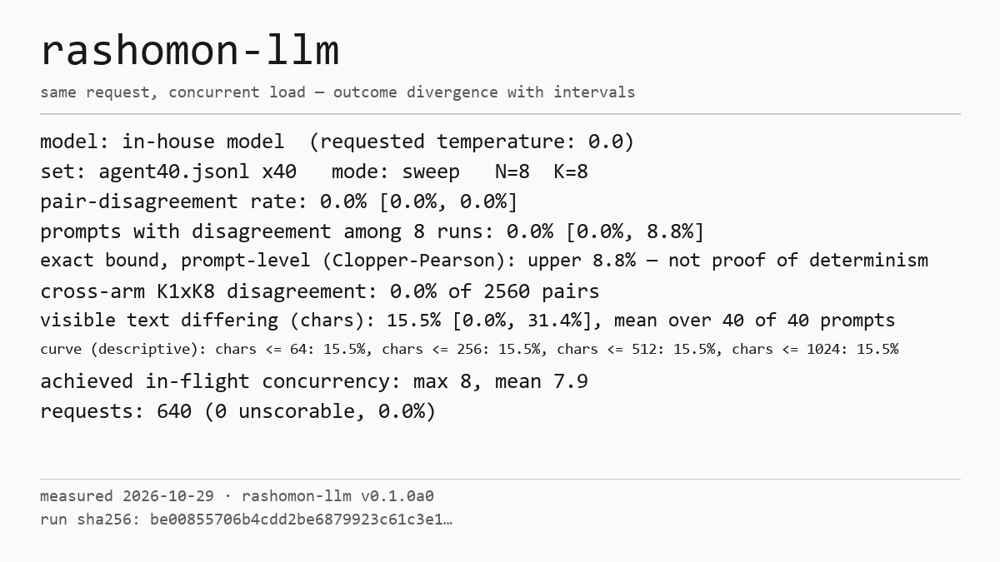
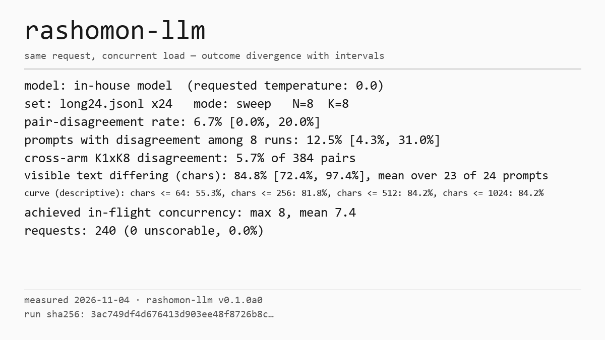

# rashomon-llm

**How often does your LLM endpoint give a different answer to the exact same request under load?**

`rashomon-llm` sends identical request parameters — same prompt, same seed if you pass one, requested temperature 0 — to any OpenAI-compatible endpoint, concurrently, the way production traffic actually arrives. Then it tells you how often the outcomes disagree, with an interval around every number.

No divergence observed does **not** mean your server is deterministic. It means this tool, on this workload, at this concurrency, did not observe one.

## Why

Documented, not folklore:

- Thinking Machines, [*Defeating Nondeterminism in LLM Inference*](https://thinkingmachines.ai/blog/defeating-nondeterminism-in-llm-inference/) (2025): LLM inference is not batch-invariant — the same request can produce different results depending on what else is in the batch.
- OpenAI documents `seed` as **best effort**, not a determinism guarantee.

Everything else is yours to measure. This tool measures; it does not fix, and it does not rank models by quality.

## Install and run

```bash
pipx install rashomon-llm

rashomon run --base-url http://localhost:8000/v1 --model my-model \
    --set agent40 --n 8 --k 8 --temperature 0 --max-tokens 2048 --out run.json

rashomon report run.json     # JSON + Markdown + a neutral PNG card
rashomon verify run.json     # recompute the report from a run file

# side-by-side against a second endpoint (e.g. a deterministic-mode server):
rashomon run --base-url ... --model my-model --set agent40 --out run.json \
    --compare-endpoint http://other-host:8000/v1
rashomon report run.json --compare run.compare.json
```

One command to run. Wall time depends on your hardware, model, and workload.

## What it measures

- **Pair-disagreement rate (headline):** across the N identical runs of each prompt, the fraction of run pairs whose *outcomes* differ, clustered by prompt family, with a bootstrap interval.
- **Prompts with disagreement among N runs** (companion, N is part of the label, e.g. "R@8"), with a Wilson interval.
- **Textual divergence:** the share of pairs whose visible text differs, averaged over prompts, with the same cluster bootstrap interval as the headline; in tokens when the server returns token ids and in characters otherwise (the unit is always printed). Pairs that are identical up to the token cap are censored and counted separately.
- **Divergence curve (descriptive, no interval):** the pooled share of pairs that differ at or before position 64 / 256 / 512 / 1024.
- **K=1 vs K=8:** a lower-client-concurrency control arm, plus the cross-arm comparison. This is a scheduling contrast, not proof of any specific cause.

The *outcome* is defined by a function, never by accuracy:

- `agent40`: the first tool call's name plus normalized arguments (no tools are executed — v1 is single-turn);
- `math40`: the extracted final numeric answer;
- `--grader yourscript.py`: your own outcome function.

Without an outcome function, only textual divergence is reported, and the tool says so.

## What it does not do

- No fixes for nondeterminism.
- No quality ranking of models or engines.
- Nothing leaves your machine unless you send it.
- No number without an interval. A degenerate interval (e.g. 0 disagreements in 20 prompts) is printed with an exact upper bound, not as proof of stability.
- No reasoning tokens. Textual divergence covers only the visible content of the response; reasoning tokens that a server returns separately are not recorded and not compared.
- No full endpoint URL in the run file unless you ask for it (`--record-base-url`); by default it keeps the scheme and a truncated hash of the host.

## How to read the bound

When every prompt agrees, the bootstrap interval collapses to `0.0% [0.0%, 0.0%]`. That is not a result, so the report adds exact Clopper-Pearson upper bounds at two levels:

- **prompt-level** — 0 of 40 prompts gives an upper bound of 8.8%. It assumes the 40 prompts are independent.
- **family-level** — the built-in sets have 5 template families of close variants, and 0 of 5 families gives an upper bound of 52.2%. This is the conservative reading.

The card carries the prompt-level bound, labelled "prompt-level"; `report.json` and `report.md` carry both. The truth for your endpoint lies somewhere under the bounds — a measured zero rules out a high divergence rate, not a moderate one.

## Method in one paragraph

Each prompt is sent once per sweep, beside other prompts, at up to K requests in flight, and the sweep is repeated N times. K is how many requests the client keeps open. A batch of identical copies sent together is a different experiment (available as `--mode burst`, labelled as such) and can understate what production sees. Full protocol: [docs/protocol.md](docs/protocol.md).

## What we measured on our own hardware

Full details, conditions and caveats: [docs/validation.md](docs/validation.md).

**Short synthetic tasks, a 2-node vLLM cluster (TP2, 2× GB10), in-house model, at requested temperature 0 and at the originating study's sampling profile:** no outcome divergence observed in any of the four runs — 0.0%, with an exact upper bound of 8.8% at the prompt level (0 of 40 prompts) and 52.2% at the family level (0 of 5 families); 40 prompts × 8 runs, K=8, with a K=1 control.



**Long reasoning tasks, one H100 NVL, in-house model** (24 prompts in 6 families; median 943 completion tokens as reported by the server, p90 at the 16,384-token cap):

- The *outcome* diverged in 6.7% of pairs [0.0%, 20.0%] at requested temperature 0 (7.1% [0.0%, 19.7%] under the originating study's sampling profile: T=1.0, top_k 20, top_p 0.95, min_p 0, seed 1).
- All of that divergence sits in one of the six families (`long_modpow`, 3 of 24 prompts). Under the study's sampling profile it sits in two families (`long_modpow`, 3 prompts; `long_lastdigits`, 1 prompt).
- 20 of 192 requests at K=8 (22 of 192 under the study's sampling profile) ended with `finish_reason=length` and an empty answer; they count as the `no_answer` outcome class, so part of the outcome divergence is "answered vs ran out of tokens".
- Only the visible answer is compared, character by character (the server returned no token ids), median 373 characters; reasoning tokens are not recorded. At K=8 that visible text differed in 84.8% [72.4%, 97.4%] of pairs: the mean over 23 of the 24 prompts (one prompt has only censored pairs), with the same family cluster bootstrap as the headline.
- In the K=1 control the visible text differed in 0.0% of pairs (24 pairs, 2 censored; exact upper bound 15.4% over 22 prompts). The control ran N=2, so this is a small sample, not a rate.



None of these numbers say anything about your server, your model, or your workload. That is the point of the tool.

## Status

Alpha. The built-in sets are synthetic, generated, and carry manifests with provenance. Validation status against each engine we test on is recorded in [docs/validation.md](docs/validation.md).

## License

Apache-2.0. See [LICENSE](LICENSE) and [NOTICE](NOTICE).
